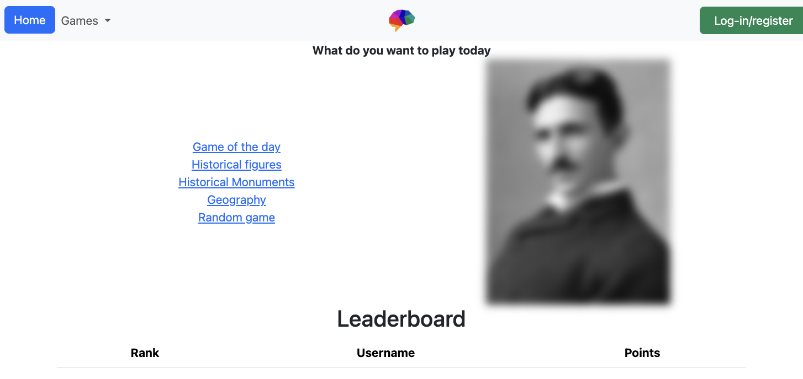
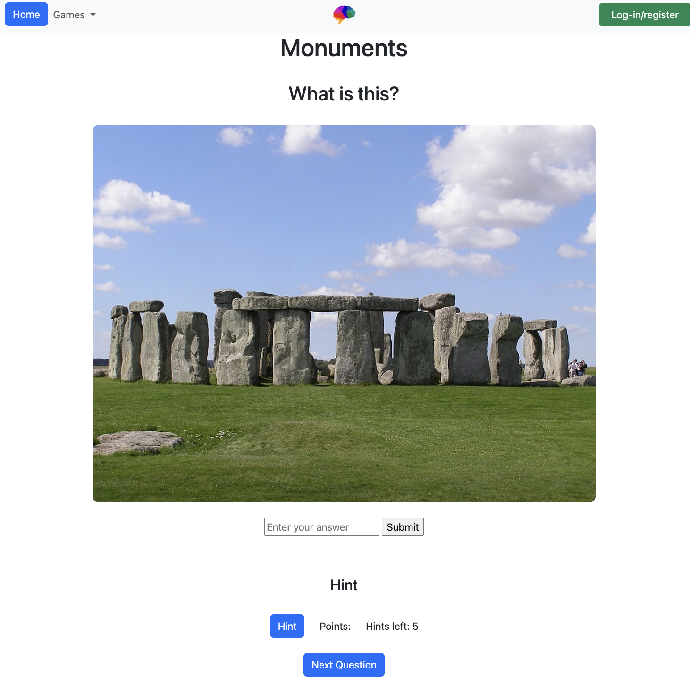

# NoItAll

## Overview

NoItAll is an educational guessing game for secondary school students (year 7 - 9). Players are shown images of historical figures, famous monuments and / or geographical locations and have to identify them.

Each game has five questions, with up to five guesses per question. Players can use hints if they get stuck, although using hints reduces the points they can earn. Scores are recorded and displayed on a leaderboard.

## Purpose

NoItAll was created to help secondary school students learn about history and geography through a guessing game.

Students can test what they already know, use hints to work out unfamiliar answers and learn more about each subject as they play.

Give it a go and be surprised at what you can learn!

## Features

- User registration and login
- Historical Figures, Monuments and Geography categories
- Game of the Day
- Five questions per game
- Five guesses per question
- Hints to help players answer questions
- Points based on the number of hints used
- Leaderboard
- Information about each correct answer
- Tracking of games played and points earned

## Technologies used

### Frontend
- HTML
- CSS
- JavaScript
- Bootstrap

### Backend
- Node.js
- Express.js
- PostgreSQL
- REST API

### Other tools
- Git and GitHub
- Docker
- Render
- Supabase
- Thunder Client

## Project layout

```text
Quasar/
│
├── client/
│   ├── assets/
│   ├── css/
│   ├── html/
│   ├── js/
│   └── README.md
│
├── server/
│   ├── __tests__/
│   ├── controllers/
│   ├── database/
│   ├── models/
│   ├── routers/
│   ├── app.js
│   ├── index.js
│   ├── README.md
│   └── package.json
│
├── Dockerfile
└── README.md
```

The `client` folder contains the HTML pages, CSS, JavaScript and images used by the website.

The `server` folder contains the Express backend, API routes, controllers, models, database files and tests.

Both folders have their own README files with more detailed information.

## Getting started

### Prerequisites

- Node.js
- NPM
- PostgreSQL database
- Docker (optional)

### Installation

**1. Clone the repository**

```
git clone https://github.com/kami1ah/Quasar.git
```

**2. Navigate to the project directory**

```
cd Quasar
```

**3. Install dependencies**

```
cd server
npm install
```

**4. Set up environment variables**

Create a `.env` file in the server directory and add your database connection URL and port.

```env
DB_URL=<your_database_url>
PORT=3000
```

Replace `<your_database_url>` with your PostgreSQL connection URL from Supabase or another database provider.

Keep the `.env` file out of GitHub by adding it to `.gitignore`.

**5. Set up the database**

Connect to your PostgreSQL database and run the setup scripts in `server/database/`.

**6. Run the application**

From the `server` directory, run:

```
npm run dev
```

To open the frontend locally, follow the instructions in `client/README.md`.

## Preview of homepage and game

Below is a screenshot of the homepage. Here users can choose between different game categories, including Historical Figures, Historical Monuments, Geography and Game of the Day. It also includes a leaderboard where players can compare their scores.



The game page displays an image that the player must identify. Players can enter their answer, submit guesses or use hints if they need help. Players can move between questions using the Next Question button.



## Running the application with Docker

Docker can be used to run the backend in a container.

### Prerequisites

- Docker Desktop installed and running
- PostgreSQL database configured
- Environment variables set up

### Docker setup

**1. Build the Docker image**

From the project directory containing the Dockerfile, run:

```
docker build -t noitall:latest .
```

This creates a Docker image called `noitall`.

**2. Run the Docker container**

```
docker run -d --name noitall-app -p 3000:3000 --env-file server/.env noitall:latest
```

This starts the container and makes the backend available at:

http://localhost:3000

The command assumes the Dockerfile starts the server on port 3000.

**3. Check the container**

```
docker ps
```

**4. Stop the container**

```
docker stop noitall-app
```

**5. Remove the container**

```
docker rm noitall-app
```

## Deployment

The application is hosted on Render.

Live application:

[Add Render deployment URL]

GitHub repository:

https://github.com/kami1ah/Quasar

## Additional documentation

More information about the frontend and backend can be found in their separate README files.

- [Frontend README](./client/README.md)
- [Backend README](./server/README.md)

